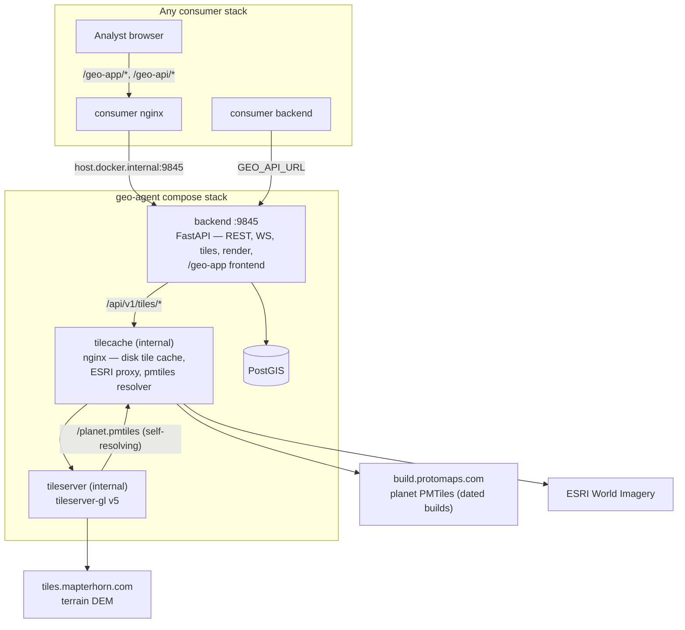

# Geo-Agent

The standalone map service. Geo-Agent owns everything map-related for
the Pytho ecosystem: the analyst map UI, basemap tile rendering and
caching, vector label tiles, map-state/overlay data, a realtime channel,
natural-language map operations, and server-side product-map rendering.

It has ONE public surface — the backend's host-published port **9845**.
Any consumer (edge stack, transitional test stacks, cloud) integrates
the same way: forward two URL prefixes to that port. Consumers never
join geo-agent's docker network and never touch its internals.

## Architecture



**backend** — FastAPI, the single public surface. REST + WebSocket +
render + all tile endpoints, plus the built React map frontend served
as static files under `/geo-app` (baked in by the multistage
Dockerfile; SPA fallback for client routes).

**tilecache** — internal nginx fronting the tileserver with an on-disk
cache (tileserver-gl has no persistent cache of its own; its deployment
docs direct you to front it with a caching proxy). 365-day TTL,
`proxy_cache_lock` collapses MapLibre's ~20-tile pan bursts into one
upstream render. Also proxies ESRI World Imagery (TMS y-flip) and hosts
the self-resolving planet PMTiles URL.

**tileserver** — tileserver-gl v5 rendering `default`, `terrain`,
`topo`, and `labels` styles from Protomaps public planet PMTiles +
Mapterhorn terrain DEM. Internal only; no host port; zero local tile
archives. (`topo`'s contour lines are not in the raster — they paint
client-side from the same DEM via the backend's `/tiles/dem` proxy.)

**db** — PostGIS (multi-arch image; runs on the aarch64 DGX Spark).
Entities, overlays, routes, snapshots.

## Self-resolving planet PMTiles

Protomaps prunes dated planet builds off its CDN after a few weeks, so
a pinned `YYYYMMDD.pmtiles` URL rots. The tileserver instead opens the
stable internal URL `http://tilecache:8080/planet.pmtiles`; an njs
handler (`infra/tilecache/pmtiles_resolver.js`) probes dated builds
counting down from tomorrow, locks onto the newest live one, and
transparently re-locks — serving the in-flight request — when the CDN
prunes it. No pinned dates, no manual bumps, no restarts. Look for
`locked onto build` / `re-locked onto` in the tilecache logs.

## Consumer integration

Everything a stack needs to embed maps:

1. **nginx**: `upstream geo_agent { server host.docker.internal:9845; }`
   plus three blocks — `/geo-app/` (proxy as-is), `/geo-api/v1/ws`
   (WebSocket upgrade), `/geo-api/` (rewrite `/geo-api/*` → `/api/*`) —
   and `extra_hosts: ["host.docker.internal:host-gateway"]` on the
   container.
2. **Backend env**: `GEO_API_URL=http://host.docker.internal:9845` —
   the one knob; `/api/v1` and `/api/v1/render` derive from it.
3. **Frontend build arg**: `VITE_GEO_AGENT_API_URL=/geo-api/v1`
   (relative — rides the stack's own nginx, no CORS).

The analyst map is then an iframe of `/geo-app/operations-map`, with
the MODE driven entirely by query params — ALL map UI and mode logic
(including the edit-session chrome) lives in this service's frontend;
consumers only assemble URLs and listen for hooks:

- **Live operations map** — `/geo-app/operations-map?map_id=…` (plus
  optional `bbox`, `user_id`, `product_type`, `coa_id`, …).
- **Read-only embed** — same route with just `map_id` + `bbox` (e.g.
  COP preview panels).
- **Edit session** — same route + `editEnabled=1&product_type=…&bbox=…`.
  Edit affordances mount (entities click-selectable and drag-movable),
  and the edit chrome — the "Editing map for …" banner + Done editing
  button, in the 16:9 exporter framing — renders IN-MAP. Layer/basemap
  toggles persist onto the map record as the analyst works.
- **Equipment catalog reference** — `/geo-app/equipment-catalog`
  (optional `?weg_id=…` deep-links one system's sheet). A read-only
  standalone reference iframe: the searchable illustrated WEG catalog
  with full datasheets. No map, no project, no writes — the per-map
  engagement-range pick only exists on the in-map mount.
- **`render=1`** (with `editEnabled=1`) — the product embeds a rendered
  figure: on Done, geo-agent triggers its OWN export render
  (`POST /render` with `replay: true, persist: true` — base spec is the
  last generation render, overridden by the session's state) and the
  done hook carries the persisted `image_url`
  (`/geo-api/v1/render/latest/{map_id}.jpg`). Without it, Done is
  hook-only — nothing renders for live-map-only products.
- **Headless render target** — `/geo-app/headless`, chrome-less, used
  only by this service's own `POST /api/v1/render`.

Two hooks cross the frame boundary, both child → parent postMessage:

- `{ type: 'geoagent.navigate', url }` — right-click generate / open in
  editor; the parent's shell calls its router.
- `{ type: 'geoagent.editDone', map_id, rendered, image_url?, error? }` —
  Done editing. The parent's ONLY job is the document-side embed:
  download `image_url` (already rendered + persisted by geo-agent) and
  swap it into the DOCX/PPTX. The parent never triggers a render.

The rendered figure itself is document content (bytes inside the
DOCX/PPTX, produced by `/render`) — it is never an embed or an iframe.

## External API

The integration surface is deliberately TINY. A consumer embeds the map
UI (iframe + two hooks — see "Frontend" below), and its backend talks to
exactly these endpoints. Everything else the map does — editing,
overlays, tiles, natural language, snapshots — happens INSIDE geo-agent
through its own embedded frontend; consumers set up none of it.

Endpoints live under `/api/v1` on port 9845 (through a consumer's nginx
the same paths appear as `/geo-api/v1/*`). JSON unless noted; no auth on
the closed mesh.

### Render — produce a product-map image

```
POST /api/v1/render
{
  "map_uuid": "<uuid>",              required
  "product_type": "SITEMP",          doctrinal gating + marginalia title
  "basemap": "default",
  "bbox": [w, s, e, n],
  "width": 1920, "height": 1080, "pixel_ratio": 1.5,
  "layers": [...], "allowed_kinds": [...],
  "basemap_layer_visibility": [...], "doctrinal_layer_visibility": [...],
  "show_topographic_contours": bool, "cluster_mil_units": bool,
  "compact_aa_labels": bool, "compact_legend_labels": bool,
  "wait_ms": 60000, "fast": false,
  "persist": true,                   store the JPG server-side (below)
  "replay": false                    re-render from the last stored spec
}
-> 200 image/jpeg   (X-Render-Ms, X-Render-Backend headers)
```

Drives a headless Chromium against geo-agent's own frontend at
`/geo-app/headless` — exported products use the exact MapLibre +
tactical-paint pipeline the analyst edits with; one renderer, no drift.
Marginalia (north-arrow declination diagram, RF scale bar, legend) bake
in here only. Two browser modes, keyed on `PYTHO_RENDER_CDP`: set (the
compose default) it connects to a host-side GPU Chromium over CDP
(spark; `infra/host/README.md`); set EMPTY (`PYTHO_RENDER_CDP=` in
`.env`) the backend launches the Chromium baked into its own image and
renders through SwiftShader — the whole loop stays inside the container,
so a GPU-less cloud host needs no host-side install at all.

Every successful non-replay render stashes its request spec per
`map_uuid`; `replay: true` re-renders from that stored spec with any
explicitly-set fields overriding — the edit-session Done uses exactly
this, so no caller ever re-supplies the generation presets.

### Fetch the current image of any map

```
GET /api/v1/render/latest/{map_uuid}.jpg     (Cache-Control: no-store)
```

Valid from a map's FIRST render onward (generation renders persist
too). This is also the `image_url` the `geoagent.editDone` hook hands
the consumer after an analyst finishes editing — the consumer downloads
it and embeds it into the document; it never triggers a render.

### Feed data onto a map (programmatic producers)

```
PUT  /api/v1/maps/{map_id}            upsert record: name, bbox, viewport,
                                      attrs (attrs merge — product_type,
                                      layer prefs; other keys preserved)
POST /api/v1/maps/{map_id}/sync       bulk source-tagged layer sync —
                                      push units / control measures /
                                      overlays as GeoJSON; geo-agent
                                      upserts + broadcasts to open maps
GET  /api/v1/map/state?map_id&bbox&kinds   read everything on a map
                                      (entities, overlays, routes) as
                                      GeoJSON
GET  /api/v1/basemaps                 basemap catalog metadata
```

This is how a product pipeline feeds live data (order-of-battle,
scenario control measures, per-product overlays) onto maps analysts
see — push once, every open map updates in realtime.

### Everything else is internal

Entities/overlays CRUD, GeoOps, routes + planning, natural language,
snapshots, COP, artifact ingest, the WebSocket, tiles and fonts, and
the persistent telemetry sink (analyst-action audit + forwarded
browser logs in the stack's own PostGIS — survives container
recreates; server errors additionally persist to a rotating log file
on the data volume) are the embedded map UI's OWN API — geo-agent's
frontend calls them through the consumer's transparent `/geo-api/`
forward. Consumers never call, wire, or configure any of it. The full surface is documented in the repo at
[docs/API.md](docs/API.md) — human-readable, generated from the OpenAPI
spec by `scripts/generate_api_docs.py`; regenerate after touching
routes (the script's docstring has the two commands).

## Frontend

`frontend/` is a React + Vite + MapLibre app with two surfaces:

- `/geo-app/operations-map` — the analyst map UI.
- `/geo-app/equipment-catalog` — standalone read-only WEG catalog
  reference (embeddable; `?weg_id=` deep-links a sheet).
- `/geo-app/headless` — chrome-less render target (same components;
  exported products and the live editor share one paint pipeline).

What the analyst gets on the operations map:

- **Four basemaps** — Default (bland tactical base for product
  overlays), Terrain (obstacle-overlay hatching), Topo (military
  topographic sheet look with client-side contour lines), Satellite
  (imagery) — switched from the Map Layers panel; the selection
  persists per map.
- **Map Features toggles** — MGRS grid, place labels with a
  prominence Detail slider (major cities → every village), contour
  lines (DEM-derived, global coverage, labeled index contours), spot
  heights. All persisted per map.
- **Weather overlay** — temperature / rain / snow / wind / clouds /
  pressure forecast rasters with a 0–72 h scrub, proxied server-side
  so the upstream API key never reaches a browser.
- **Live order of battle** — units stream onto the map from the
  consumer's sync push, with MIL-STD-2525D symbology, unit-name
  labels, an echelon roll-up slider (collapse battalions into their
  parent formations), and a unit metadata panel (composition tree,
  linked equipment, activity).
- **Tactical overlays** — the sidebar gates per-product layer sets
  (control measures, threat/event templates, per-COA overlays, signal
  reports); doctrinal graphics paint through an SVG pass that
  reprojects with the camera.
- **Per-target generate** — right-click a hostile unit (or use the
  metadata panel) to fire per-target product chains; a badge marks
  units whose target-intelligence handoff has already been pushed.
- **Edit sessions** — entities click-selectable and drag-movable,
  in-map banner + Done, 16:9 exporter framing, render-replay on Done.

Map style + basemap catalog mirror live in
`frontend/src/geo-agent/utils/mapStyles.js`. The frontend is baked into
the backend image by the multistage `backend/Dockerfile` (node build →
`/srv/geo-agent`); a frontend change ships via an image rebuild and
consumers need nothing.

## Project structure

```
geo-agent/
├── backend/
│   ├── Dockerfile            # multistage: frontend build → python runtime
│   └── app/
│       ├── api/v1/           # REST endpoints (router.py registers all)
│       │   ├── tiles.py      # tile + font proxying (via tilecache)
│       │   ├── render.py     # POST /render
│       │   ├── map_state.py, entities.py, overlays.py, routes.py,
│       │   ├── geoops.py, nl.py, maps.py, history.py, cop.py,
│       │   └── artifacts.py, custom_symbols.py, config.py, ws.py
│       ├── services/
│       │   ├── render/       # headless.py — CDP/Playwright driver
│       │   ├── ingestion/    # shapefile / geojson / geotiff parsers
│       │   ├── knowledge/    # spatial queries, GeoOps exec, terrain
│       │   ├── nl/           # LangChain agent, tools
│       │   ├── realtime/     # WebSocket sessions
│       │   └── cop/, llm/, view/
│       ├── models/           # SQLAlchemy + GeoAlchemy2
│       └── schemas/          # Pydantic v2 (incl. GeoOps DSL)
├── frontend/                 # React + Vite + MapLibre map UI
├── infra/
│   ├── tilecache/            # internal cache nginx.conf + pmtiles_resolver.js
│   ├── tileserver/           # tileserver-config.json + styles + sprites
│   ├── host/                 # spark host-side Chromium CDP units (GPU render)
│   └── scripts/init-db.sql
├── scripts/                  # install_geoagent.sh, data loaders, sprites
├── docker-compose.yml        # THE compose file — the whole stack
├── rebuild.sh                # sanctioned rebuild (api|frontend|tiles|db|all)
├── deploy.sh                 # full rebuild + deep verification battery
└── develop.sh                # local dev helper (db shell, logs, …)
```

## Quick start

```bash
git clone <repo-url> && cd geo-agent
./deploy.sh                 # full stack up + verification battery

# analyst UI
open http://localhost:9845/geo-app/operations-map
```

## Rebuild / deploy

Never hand-roll `docker compose` chains — the scripts encode which
change needs which action (and every run ends with verification against
the public surface):

```bash
./rebuild.sh api        # backend code / requirements / Dockerfile —
                        # rebuilds + recreates the backend container
./rebuild.sh frontend   # frontend change (baked into the backend image
                        # by the multistage Dockerfile — same path)
./rebuild.sh tiles      # tilecache/tileserver conf, styles, sprites,
                        # pmtiles resolver — FORCE-recreate: a running
                        # container keeps serving the OLD bind-mount
                        # inode after git pull rewrites the file
./rebuild.sh db         # database service only
./rebuild.sh            # full stack

./deploy.sh             # production path: full rebuild + deep checks
                        # (health, catalog, every tile shape incl.
                        # topo + DEM, /geo-app, headless target,
                        # render/latest + render/spec routes)
```

Neither script touches git — pull is the operator's step, then run the
script:

```bash
git pull --ff-only && ./deploy.sh
```

## Environment variables

Every deployment knob is documented in [.env.example](.env.example) —
copy to `.env` and set what differs; an empty `.env` is a valid
deployment. The short version:

- `GEO_DATA_DIR` — host dir mounted at `/app/data`: offline assets
  under `offline/`, persisted renders under `renders/`.
- `OFFLINE_MODE` — offline asset loaders.
- `PYTHO_RENDER_CDP` — set: host GPU Chromium over CDP (spark); EMPTY:
  in-container bundled Chromium with SwiftShader (cloud). With
  `GEO_AGENT_RENDER_HOST_BASE`, `RENDER_CONCURRENCY`, `RENDER_WEBGL` —
  the render pipeline (see `infra/host/README.md`).
- `ALLOWED_ORIGINS`, `ALLOWED_ORIGIN_REGEX` — CORS for direct-origin
  dev only; production consumers are same-origin through their own
  nginx.
- AWS credentials — the NL agent (Bedrock) + optional S3 storage.
- `OWM_API_KEY` — the analyst weather overlay (forecast raster tiles
  proxied through the tile plane; the key stays server-side) and
  route weather scoring. Without it the weather buttons 503 cleanly.
- `DEFAULT_VIEW` — per-deployment first-open camera (`lng,lat,zoom`)
  for stacks with no saved viewport yet.

`DATABASE_URL` and `TILECACHE_URL` are wired by compose to the stack's
own containers — they matter only when running the backend bare.

## Multi-tenant scopes

Every row is scoped GLOBAL (shared base layers), WORKSPACE (org/team),
SESSION (scenario instance), or USER (private drafts); queries return
the union of the four.

## Tech stack

FastAPI + Uvicorn; PostgreSQL 16 + PostGIS 3.4 (SQLAlchemy 2 + asyncpg +
GeoAlchemy2); Shapely / GeoPandas / Fiona / Rasterio / GDAL; LangChain
(Bedrock) for NL; MapLibre GL + React + Vite frontend; milsymbol +
mil-sym-ts for MIL-STD-2525D symbology; tileserver-gl v5 + nginx (njs)
tile plane; Playwright/CDP headless Chromium render.

## License

Proprietary
